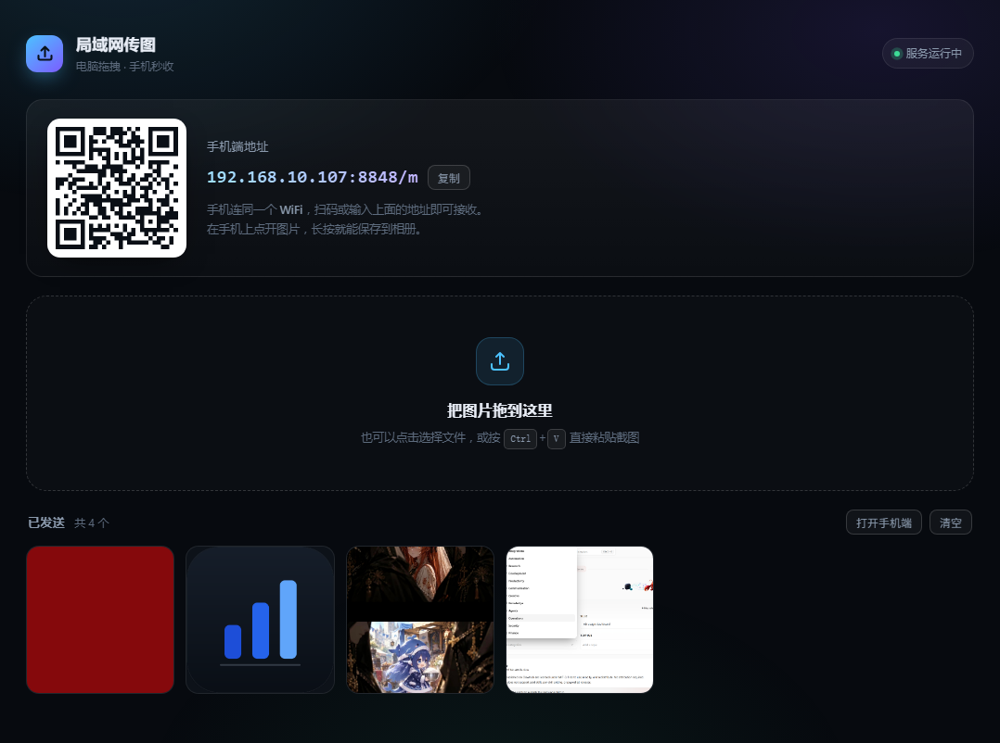

# 局域网传图

电脑上把图片拖进网页，手机浏览器里立刻出现 —— 同一个 WiFi 下，不用数据线、不用微信、不用装 App。



## 怎么用

### 方式一：下载 exe（推荐，不需要装 Python）

到 [Releases](../../releases/latest) 下载 **`LanShare.exe`**，双击运行即可（窗口标题是「局域网传图」）。

### 方式二：跑源码（需要 Python 3）

克隆本仓库，双击 `启动传输.bat`。

---

启动后：

1. 手机连上和电脑**同一个 WiFi**
2. 手机扫电脑网页上的**二维码**（或手动输入 `http://电脑IP:8848/m`）
3. 电脑上把图片拖进网页 —— 手机页面 2 秒内自动出现
4. 手机上点开图片，**长按保存到相册**

传完不用管，下次打开手机页面还能看到历史文件。

两种方式不会打架 —— 重复启动时会自动检测，直接打开已在运行的页面，不会起第二个实例。

## 支持的传法

| 方式 | 操作 |
|---|---|
| 拖拽 | 直接把文件拖到网页任意位置 |
| 选择文件 | 点击虚线框，可多选 |
| 粘贴截图 | 截图后按 `Ctrl + V`，自动命名保存 |

图片以外的东西（PDF、APK、视频…）也能传，只是显示成文件卡片。

## 常见问题

**手机打不开页面？**
- 确认手机和电脑连的是同一个 WiFi（有些路由器分了 2.4G / 5G 两个名字，也属于同一局域网，一般没问题）
- 第一次运行时 Windows 会弹防火墙提示，**必须勾选「专用网络」并点允许**。如果当时点了取消，去「Windows 安全中心 → 防火墙和网络保护 → 允许应用通过防火墙」里把 Python 勾上
- 电脑网页上如果显示了多个 IP，用下拉框换一个试试（多网卡 / 虚拟网卡场景）

**怎么确认手机连上了？**
看启动窗口的日志，手机一访问就会打印一行 `[192.168.1.x] "GET /m HTTP/1.1" 200`。
手机端每 2 秒轮询一次列表，这类轮询日志已自动过滤，不会刷屏。

**控制台偶尔出现 `ConnectionResetError` 之类的报错？**
旧版本会有，现在已经静默处理了 —— 手机浏览器加载完页面主动断开连接是正常行为，不是故障。

**exe 被杀毒软件拦了？**
PyInstaller 打包的程序偶尔会被误报（尤其是 360、火绒）。加个信任/白名单即可，程序本身只做本地局域网通信，不联网、不上传任何数据到外部。

**exe 启动比 bat 慢一两秒？**
单文件 exe 每次启动要先把内置资源解压到临时目录，属于正常现象。

**把 exe 拷到别的电脑还能用吗？**
能，单文件自包含。对方电脑不需要装 Python，但同样需要放行防火墙。

**端口被占用？**
程序会自动从 8848 往后找空闲端口，网页上显示的地址就是实际地址。

**文件存在哪？**
`uploads/` 目录。网页上的「清空」按钮会真删文件，删之前会二次确认。

## 技术说明

- 纯 Python 标准库（`http.server`），**零依赖**，不需要 `pip install`
- 上传走 `PUT` 原始字节流，不经过 base64 编码，大图也不吃内存
- 文件名做了去重（`图片.png` → `图片 (2).png`）和路径穿越过滤
- 手机端每 2 秒轮询一次文件列表，无需 WebSocket
- 二维码用本地的 `static/qrcode.min.js`，完全离线可用

## 目录结构

```
LANPictureFromPCtoMobile/
├── 启动传输.bat        源码方式启动（需要 Python 3）
├── server.py           服务端
├── static/             网页界面
│   ├── desktop.html    电脑端
│   ├── mobile.html     手机端
│   └── qrcode.min.js   二维码库
├── app.ico             图标（重新打包时用）
├── 预览-电脑端.png      界面截图
└── 预览-手机端.png
```

> `LanShare.exe` 不打进仓库（体积原因），发布在 [Releases](../../releases)。
> 运行时生成的 `uploads/` 已在 `.gitignore` 中排除。

重新打包命令（需要 `pip install pyinstaller pillow`）：

```bat
pyinstaller --onefile --console --name LanShare --icon app.ico ^
            --add-data "static;static" server.py
```
